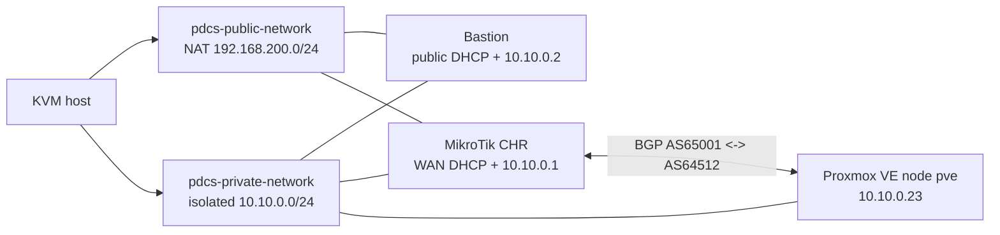

# Scenario: Proxmox, EVPN and BGP with a Public IP

> Status: draft · Level: advanced · Estimated duration: to be measured

## Objective

In a disposable environment, a test VM receives routed connectivity through a
MikroTik CHR router, and only the intended prefixes circulate over BGP. The
Proxmox node can be nested in a KVM VM (lab) or be a real server
(production).

## Architecture



Networking rules:

- the private network (10.10.0.0/24) has **no address on the KVM host**: the
  node is not reachable directly and must be reached through the bastion
  (`ssh -J lab_user@<bastion> root@10.10.0.23`, API via the tunnel);
- the bastion is the only entry point (public DHCP on the NAT network +
  10.10.0.2/24 on the private network);
- the CHR is the gateway/DNS of the private network (10.10.0.1) and NATs it
  to the public network, with the BGP peering to the node (AS 65001 <-> 64512);
- addresses, ASNs and prefixes use documentation ranges (RFC 5737).

## Prerequisites

- Proxmox VE 9.2; OpenTofu >= 1.8 with the bpg/proxmox provider >= 0.70.
- For the nested lab: KVM/libvirt with nested virtualization.
- MikroTik CHR license (bandwidth-limited without a license).
- Terragrunt >= 1.0 and OpenTofu on the host (the provisioning step uses them).
- A **git clone** of `pdcs-core-tf-modules` at the repo root
  (`pdcs-core-tf-modules/`, checked by `dependencies-check`). It is read-only:
  the scenario never modifies it. The clone must contain the pinned tag
  (see "Terragrunt provisioning" below); refresh it with
  `git -C pdcs-core-tf-modules fetch --tags` after each module release.
- A valid MikroTik account with CHR license activation rights. Its credentials
  are entered locally in the two required `scenario.yaml` values and must not
  be committed.

## Terragrunt provisioning

`infra/terragrunt/` is the client project extracted from
`terragrunt-client.zip`. It runs three units in dependency order — the same
three-layer layout as the modules:

```
01-foundation -> 02-networking -> 03-compute
```

The EVPN zone lives in the foundation state with its controllers: since
modules v0.1.0 the foundation module orders them (controllers created
first, zones destroyed first), so destroy removes compute, networking, then
zones and controllers without Proxmox rejecting a controller deletion while
a zone still references it.

### BGP peering with the CHR

Two different SDN controllers coexist on the node:

- the **EVPN controller** (`frrbgp`, type `evpn`) manages the local VNet/EVPN
  fabric used by the VMs (single-node fabric: its peer is the node itself),
  created in `01-foundation`;
- a **BGP controller** (`bgpchr`, type `bgp`, AS 64512, peer 10.10.0.1,
  eBGP) provides the plain IPv4 BGP session with the MikroTik CHR — a
  native `sdn_controllers` input since modules v1.0.0-rc2. The
  `02-networking` unit depends on foundation (zones and controllers
  fingerprints) before creating VNets.

The CHR side uses the same settings as `mikrotik-script`: plain eBGP,
CHR AS 65001 <-> node AS 64512, IPv4 unicast only (no EVPN address family).
The CHR image is pinned to RouterOS 7.25 (`afi=evpn` needs >= 7.24, but the
peering itself is plain BGP).

The units consume `pdcs-core-tf-modules` through an **immutable pinned tag**.
Both the repository URL and the tag are defined once in
`infra/terragrunt/root.hcl`:

```hcl
locals {
  core_modules_repo    = "file://${local.repo_root}/pdcs-core-tf-modules"
  core_modules_version = "v1.0.0-rc1"
}
```

Every unit sources
`git::${local.core_modules_repo}//<layer>?ref=${local.core_modules_version}`,
so the provisioning is reproducible: the tag resolves to exactly one commit,
whatever the state of the local clone's branches. Terragrunt clones the whole
repository (so the modules' `../modules/...` sibling paths resolve); the clone
is never modified. `dependencies-check.sh` verifies that the clone contains
the pinned tag (`git -C pdcs-core-tf-modules fetch --tags` after a module
release) before any provisioning step runs. The provider and
the local state backend are generated per unit by `root.hcl`; states stay in
`infra/terragrunt/*/terraform.tfstate` (ignored by git). The orchestrator
runs `terragrunt run --all apply` for the install and
`terragrunt run --all destroy` for the cleanup. Manual use:

```bash
cd infra/terragrunt
terragrunt run --all validate --non-interactive
terragrunt run --all plan --non-interactive
terragrunt run --all apply --non-interactive
terragrunt run --all destroy --non-interactive
```

### Bumping the pinned module version

1. Read the modules repository `CHANGELOG.md` (and the migration notes when
   the bump is a major or a release-candidate change).
2. Update `core_modules_version` in `infra/terragrunt/root.hcl` — it is the
   only place to change; every unit picks it up.
3. Refresh the local clone: `git -C pdcs-core-tf-modules fetch --tags`
   (`dependencies-check.sh` fails with an explicit message otherwise).
4. **If the release removed a `generate` block** (a module capability
   replaced a workaround), clear the Terragrunt cache — Terragrunt never
   deletes files it generated, and the stale file collides with the native
   module capability:
   ```bash
   rm -rf infra/terragrunt/*/.terragrunt-cache
   ```
   (v1.0.0-rc2 does: run this once when switching from v1.0.0-rc1.)
5. Review with `terragrunt run --all plan --non-interactive`, then apply.

At publication (public GitHub repository): switch `core_modules_repo` to the
public URL in the same `root.hcl` block — the local-clone requirement and the
`safe.directory` handling disappear with it.

## Post-deployment validation

After a **completed** install, validate the three objectives of the
scenario with the e2e tests (they re-use the persisted environment from
`.state/`; see `tests/e2e/README.md` for the standalone usage):

```bash
cd tests/e2e
./test-zone-evpn.sh       # EVPN zone applied + running, vnet + subnet
./test-bgp.sh             # BGP session node<->CHR established
./test-vm-joignable.sh    # every VM answers (ICMP + sshd)
```

Chaos phase: `chaos/scripts/bgp-flap.sh` flaps FRR on the node and asserts
the recovery through `test-bgp.sh`
(`orchestrator -scenario scenario.yaml -phase chaos -continue-on-error`).

## Scope

- **Included**: EVPN zone + VNet creation, BGP peering node-CHR, test VM
  reachability.
- **Excluded**: persistent production use, real prefixes, any traffic
  outside the lab.

## Access after deployment

The node is intentionally unreachable from the KVM host (no route to
10.10.0.0/24). Use the bastion as the only entry point:

```bash
KEY=scenarios/proxmox-evpn-bgp-public-ip/.ssh/id_ed25519
BASTION=lab_user@<bastion-public-ip>          # from: virsh net-dhcp-leases pdcs-public-network

# SSH to the Proxmox node through the bastion
ssh -i $KEY -J $BASTION root@10.10.0.23

# Proxmox web UI through a local tunnel
ssh -i $KEY -N -L 127.0.0.1:8443:10.10.0.23:8006 $BASTION
# then browse https://127.0.0.1:8443
```

The `bastion-proxy` step uses the same idea for Terragrunt: an SSH tunnel
(API on 127.0.0.1:8443) and a SOCKS proxy (provider SSH for snippets), only
through the bastion.

## Run the scenario

Everything runs through the Go orchestrator binary: it resolves the
manifest-owned environment and persisted runtime values, then executes every
step in dependency order. The `up.sh` / `down.sh` / `reset.sh` wrappers are
thin shortcuts around it.

```bash
# Fill MIKROTIK_LICENSE_EMAIL and MIKROTIK_LICENSE_PASSWORD in scenario.yaml
# with local values before running; do not commit those credentials.

# Recommended on a clean host: run everything inside the tools container
# (host network + libvirt socket, nothing installed on the host)
docker/run.sh build
docker/run.sh up        # install
docker/run.sh down      # teardown
docker/run.sh shell     # debug shell

# Or natively, from the repo root (build once):
make build

# Install everything in one go:
./orchestrator/bin/orchestrator \
  -scenario scenarios/proxmox-evpn-bgp-public-ip/scenario.yaml \
  -root scenarios/proxmox-evpn-bgp-public-ip -auto

# Full teardown in one go (cleanup uses the install's private scenario state):
./orchestrator/bin/orchestrator \
  -scenario scenarios/proxmox-evpn-bgp-public-ip/scenario.yaml \
  -root scenarios/proxmox-evpn-bgp-public-ip -down

# Shortcuts (from anywhere), extra flags are forwarded:
scenarios/proxmox-evpn-bgp-public-ip/infra/scripts/up.sh      # install
scenarios/proxmox-evpn-bgp-public-ip/infra/scripts/down.sh    # teardown
scenarios/proxmox-evpn-bgp-public-ip/infra/scripts/reset.sh   # down + up
```

All scenario variables are defined in the `env:` block of `scenario.yaml`.
The manifest is the only configuration source: the orchestrator does not read
`.env` files or fall back to environment values. Required values are checked
before any step runs.

The two values the operator must enter locally are:

- `MIKROTIK_LICENSE_EMAIL`
- `MIKROTIK_LICENSE_PASSWORD`

They are passed only to the CHR configuration step, which activates and
verifies the `p-unlimited` license. The input check runs after the ISO has
been downloaded but before any lab VM or network is created. Keep those local
values out of commits; after filling them, resume with `docker/run.sh resume`.
The PVE ISO URL and official SHA-256 are in `scenario.yaml`; the first run
downloads the ISO to `assets/` and verifies it before installation. The KVM
image store, downloaded ISO, generated SSH key and other assets all live under
the scenario directory so Docker can access them through the repository mount.

The orchestrator generates `LAB_VM_PASSWORD` and `PVE_ROOT_PASSWORD` once and
stores them in the private, gitignored `.state/<scenario>.json` file (mode
0600). Steps publish runtime values such as the SSH key path/public key, CHR
IP, bastion endpoint and Proxmox API token to the orchestrator through a
dedicated output channel. The Go process stores those values in the same state
file and injects the current environment into each subsequent step. `-resume`
and `-down` reuse those persisted values without an `.env` file.

The Terragrunt units read those persisted values with `get_env()`:
`03-compute` injects `LAB_VM_PASSWORD` (generated) and `LAB_VM_SSH_KEY`
(published by the `ssh-keygen` step) into the cloud-init template through
`template_vars` and `ssh_keys`, so no credential is ever written in the
repository. The matching `requires_env` entries make the orchestrator fail
early with an actionable message when a value is missing.

Other deployment settings (network, PVE addressing, timezone and usernames)
are also explicit `value:` entries in `scenario.yaml`. Change them there;
relative paths are resolved from the scenario root.

All deployment scripts are idempotent: re-running the install on an
already deployed host fails on nothing - existing networks, images and VMs
are detected and skipped. Teardown is idempotent too.

## Links

- Constraints: [`docs/constraints.md`](docs/constraints.md)
- Architecture: [`docs/architecture.md`](docs/architecture.md)
- Disk/storage paths: [`docs/storage.md`](docs/storage.md)
- Chaos experiments: [`chaos/experiments.md`](chaos/experiments.md)
- Authorized red-team scope: [`redteam/scope.md`](redteam/scope.md)
