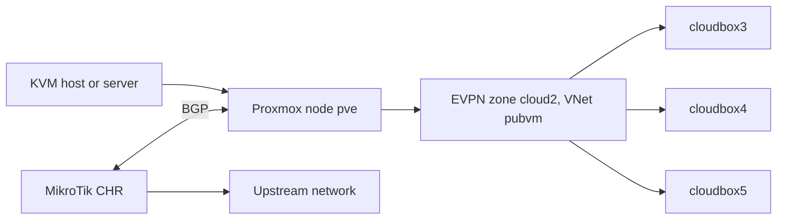

# Architecture

## Diagram

## Logical names -> implementation

| Logical name | Implementation | Defined in |
|--------------|----------------|------------|
| Proxmox node | `pve` | `scenario.yaml` (`PROXMOX_NODE_*`) |
| EVPN zone | `cloud2` | `infra/terragrunt/01-foundation` (with its controllers) |
| EVPN controller (zone fabric) | `frrbgp` | `infra/terragrunt/01-foundation` |
| Plain BGP controller (CHR peering) | `bgpchr` (`type = "bgp"`) | `infra/terragrunt/01-foundation` |
| VNet | `pubvm` (VLAN 15) | `infra/terragrunt/02-networking` |
| Test VMs | `cloudbox3` `172.16.50.26` / `cloudbox4` `172.16.50.16` / `cloudbox5` `172.16.60.16` | `infra/terragrunt/03-compute` |
| Provisioning | `infra/terragrunt/` (OpenTofu + Terragrunt, `bpg/proxmox` provider) | — |

> If this table disagrees with the units, **the code wins** (`scenario.yaml`
> and `infra/terragrunt/*.hcl` are the source of truth; fix the docs).

## Design decisions

- **EVPN zone** (`cloud2`): the Proxmox SDN EVPN zone carries the VMs; its
  fabric controller (`frrbgp`) runs the EVPN/BGP fabric.
- **Plain BGP peering**: a separate controller (`bgpchr`, native module
  capability since modules v1.0.0-rc2) peers the node with the MikroTik
  CHR — the EVPN fabric is not involved in that peering.
- **BGP policy**: only intended prefixes circulate (prefix-list filtering on
  both sides). Sample values use documentation ranges: ASN `64512`,
  peers `10.10.0.1` (CHR) / `10.10.0.23` (node).
- **VNet**: `pubvm`, VLAN tag `15`, subnets `172.16.50.0/24` and
  `172.16.60.0/24`, DHCP range `172.16.50.35-95` (IPAM `pve` + dnsmasq).
- **Disposable by design**: nested KVM lab or real node; state kept per
  environment under `.state/` so a run can be resumed.

## Provisioning layers

| Layer | What it does |
|-------|--------------|
| foundation | Bridges, SDN controllers and zones (module-managed ordering), storage roles, downloaded OS images |
| networking | VNets and subnets (SDN) |
| compute | VMs (cloud-init, static IPs from the ranges) |

Provisioning runs from `infra/terragrunt/` (OpenTofu through Terragrunt,
`bpg/proxmox` provider); guest configuration is done through cloud-init
(no Ansible layer in this scenario).

## Verification

The e2e scripts under `tests/e2e/` assert the three objectives:

1. `test-zone-evpn.sh` — the EVPN zone is applied and DHCP hands out an
   address from the range;
2. `test-bgp.sh` — the BGP session node↔CHR is established; only planned
   prefixes circulate;
3. `test-vm-joignable.sh` — test VMs answer on their public address.

## Chaos / Red team (optional phases)

- `chaos/scripts/bgp-flap.sh` — restart/flap the BGP session and observe
  convergence (journal in `chaos/experiments.md`).
- Red-team reconnaissance is only allowed within
  `redteam/scope.md`; findings go into `redteam/writeup.md` after the fact.
