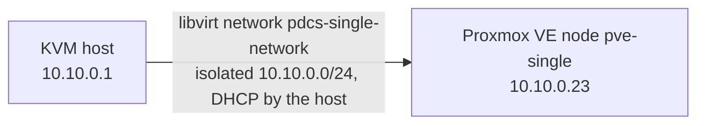

# Scenario: Proxmox single node (baseline, fresh & clean)

> Status: draft · Level: beginner · Estimated duration: ~30 min (mostly the
> unattended Proxmox installation)

## Objective

Deploy **exactly one standalone Proxmox VE node** on a local KVM host
(nested virtualization) or on a real server, fully installed and ready to
use, **without provisioning any Proxmox resource on top**: no VMs, no LXC,
no cluster, no custom storage. The node is the raw material for manual tests
and custom scripts.

A preparation step makes the node "ready to use" right away:

- **dnsmasq** — local DNS/DHCP server for guests and IPAM-style test scripts;
- **FRR** — BGP/OSPF routing daemon, enabled and ready to configure;
- **enterprise repositories** — optionally disabled (default `true`) in favor
  of the `pve-no-subscription` repository, so `apt` keeps working on an
  unlicensed node. Controlled by `PVE_DISABLE_ENTERPRISE` in `scenario.yaml`
  (`true|false` or `yes|no`).

## Architecture



- the node lives on an isolated libvirt network; the **host serves DHCP/DNS**
  (libvirt dnsmasq) and the node address `10.10.0.23` is **reserved by MAC**
  (`52:54:00:00:00:44`);
- unlike the EVPN/BGP scenario, there is **no bastion**: the node is directly
  reachable from the host over SSH and the Web UI;
- addresses use documentation ranges (RFC 5737).

## Prerequisites

- Linux host with KVM (`/dev/kvm`) and libvirt (`qemu:///system`); the
  scenario runs natively or inside the tools container (`docker/run.sh`).
- Proxmox VE installation ISO (downloaded and verified automatically by the
  `download-proxmox-iso` step).

## Default credentials and access

The orchestrator generates a **root password** (`PVE_ROOT_PASSWORD`) once and
keeps it in the private, gitignored `.state/proxmox-single-node.json` (mode
0600). Read it with:

```bash
jq -r '.env.PVE_ROOT_PASSWORD' .state/proxmox-single-node.json
```

An SSH key pair is generated under `.ssh/id_ed25519` (or reused) and its
public key is installed on the node (answer file `root-ssh-keys`).

Once the scenario is deployed:

```bash
# SSH (key, no password prompt)
ssh -i scenarios/proxmox-single-node/.ssh/id_ed25519 root@10.10.0.23

# Proxmox web UI
# -> https://10.10.0.23:8006  (user: root, password: PVE_ROOT_PASSWORD from .state/)
```

## Run the scenario

Everything runs through the Go orchestrator binary. Recommended on a clean
host: run everything inside the tools container (host network + libvirt
socket, nothing installed on the host).

```bash
docker/run.sh build
docker/run.sh up        # install (orchestrator -auto)
docker/run.sh down      # teardown
docker/run.sh shell     # debug shell (full scenario environment)

# Or natively, from the repo root (build once):
make build

# Install everything in one go:
./orchestrator/bin/orchestrator \
  -scenario scenarios/proxmox-single-node/scenario.yaml \
  -root scenarios/proxmox-single-node -auto

# Full teardown in one go (cleanup reuses the install's private state):
./orchestrator/bin/orchestrator \
  -scenario scenarios/proxmox-single-node/scenario.yaml \
  -root scenarios/proxmox-single-node -down

# Shortcuts (from anywhere), extra flags are forwarded:
scenarios/proxmox-single-node/infra/scripts/up.sh      # install
scenarios/proxmox-single-node/infra/scripts/down.sh    # teardown
scenarios/proxmox-single-node/infra/scripts/reset.sh   # down + up
```

All scenario variables are defined in the `env:` block of `scenario.yaml`;
the manifest is the only configuration source (no `.env` files). Deployment
settings (node address, memory/disk of the VM, keyboard, timezone, ...) are
explicit `value:` entries — change them there. The only operator decision is
`PVE_DISABLE_ENTERPRISE` (`true` by default, `true|false` or `yes|no`),
honored by the `proxmox-node-prep` step.

All deployment scripts are idempotent: re-running the install on an already
deployed host fails on nothing. Teardown is idempotent too.

## Scenario steps

| Step | Script | Purpose |
|------|--------|---------|
| `check-dependencies` | `infra/scripts/dependencies-check.sh` | host tools + libvirt + KVM |
| `download-proxmox-iso` | `infra/scripts/download-proxmox-iso.sh` | download + verify the ISO |
| `ssh-keygen` | `infra/scripts/ssh-keygen.sh` | generate/reuse the lab SSH key |
| `kvm-network-creation` | `infra/scripts/kvm-net-creation.sh` | create the libvirt network (DHCP) |
| `proxmox-vm-creation` | `infra/scripts/proxmox/run.sh` | unattended PVE install from the ISO |
| `proxmox-node-prep` | `infra/scripts/proxmox/node-prep.sh` | dnsmasq + FRR, enterprise repositories switch |

## Scope

- **Included**: one standalone Proxmox VE node, SSH + Web UI access, node
  preparation packages (dnsmasq, FRR) and the optional enterprise-repository
  switch.
- **Excluded**: clustering, storage solutions, guest VMs/LXC, custom
  networking — by design (this is the baseline to build on).

## Links

- Architecture: [`docs/architecture.md`](docs/architecture.md)