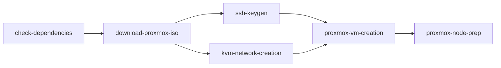

# Architecture — Proxmox single node (baseline)

## Goal

A fresh, standalone Proxmox VE node used as raw material for tests: the
scenario provisions **nothing** on top of the base installation. The node
preparation step installs the packages needed to play with it right away.

## Networking

A single libvirt network `pdcs-single-network` (`pdcs-single-br`, NATed
bridge, `10.10.0.0/24`):

- the **KVM host owns the gateway/DNS address** `10.10.0.1`, serves DHCP
  (libvirt dnsmasq) and provides outbound Internet access through NAT;
- the node MAC `52:54:00:00:00:44` is pinned to `10.10.0.23` by the DHCP
  static lease, so the address never changes between runs;
- the node is **directly reachable** from the host: `ssh root@10.10.0.23`,
  `https://10.10.0.23:8006`.

## Deployment flow

1. The ISO is downloaded once, verified against its official SHA-256 and
   cached under `assets/`.
2. The SSH key pair (`.ssh/id_ed25519`) is generated or reused; its public
   key goes into the unattended answer file (`root-ssh-keys`).
3. The network is created with the DHCP static lease.
4. `virt-install` boots the prepared ISO (answer file rendered from
   `infra/scripts/proxmox/pve.toml.tpl`) and waits for the unattended
   installation to finish.
5. `proxmox-node-prep` configures the node over SSH: `dnsmasq` + `frr`
   installed, enterprise repositories commented out and `pve-no-subscription`
   enabled when `PVE_DISABLE_ENTERPRISE` is `true`/`yes`, `snippets` content
   type enabled on `local`.

## Teardown

`-down` removes the VM and its disks/ISO, then the network — both steps are
idempotent. The `.state/`, `logs/`, `.ssh/`, `assets/` and `runtime/`
directories stay (gitignored) so a later `up` reuses the cached ISO and key.

## State and secrets

- `PVE_ROOT_PASSWORD`: generated once by the orchestrator, stored in
  `.state/proxmox-single-node.json` (mode 0600), reused by `-down` and
  subsequent runs.
- No credential is ever written in the repository.